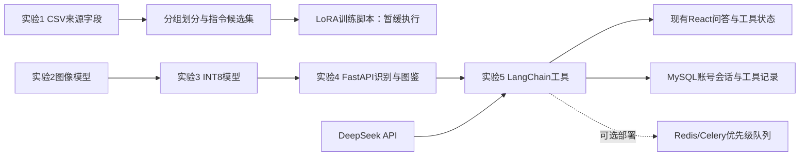

# 实验五：中草药 Agent

本实验复用现有平台，用 DeepSeek API 与 LangChain `create_agent` 实现植物工具调用。不下载基座大模型。按本次确认，云端训练环境、实际训练及成员分工暂不开展。

## 已实现

- Agent 工具：`search_plants`、`plant_details`、`recognize_plant_image`、`classify_plant_text`。
- `POST /api/v1/agent/chat`：JSON 回答，包含 `user`、`agent`、`tool_calls`、`elapsed_ms`、会话编号与保存状态。
- `POST /api/v1/agent/chat/stream`：NDJSON 实时工具执行状态与最终结果；只展示执行状态，不输出内部推理过程。
- `POST /api/v1/text/classify`：植物科普文本零样本分类。
- 首页沿用原问答区域，支持上传植物图片、查看工具结果、历史续聊。
- 工具记录与原问答共同存入 MySQL `chat_messages.references_json`，兼容原来的参考资料数组，不需要新增表或重置数据。
- 图片工具通过账号所有权检查后读取已上传原图，再调用实际 INT8 分类器；不接受任意磁盘路径或外部 URL。
- 单个工具最多 3 次重试；不存在和无权限记录不重试。未知工具报告 `ToolNotFound`。
- 本机最多 4 个 Agent 请求执行、16 个等候，超出容量返回 429，等待过久返回 503。
- 可选 Redis/Celery 工具队列、图片任务优先级与 Docker 配置已提供。当前本机未安装 Docker/Redis 服务，尚未实测分布式部署。

## 启动

项目虚拟环境安装 `TCMP-300/requirements-api.txt` 后，使用根目录现有 `一键启动.bat`。密钥继续保存在被 Git 忽略的 `TCMP-300/.env`，仅发送到配置的模型服务；代码显式关闭 LangSmith 跟踪，不向其发送会话。

本机默认 `AGENT_QUEUE_ENABLED=false`，直接执行工具，可立即使用。旧 `/api/v1/chat` 保留兼容，首页调用新的流式 Agent 接口。

启用已有 Redis 的队列环境：在本机忽略的 `.env` 配置 `AGENT_QUEUE_ENABLED=true`、`CELERY_BROKER_URL`、`CELERY_RESULT_BACKEND`，再运行：

```powershell
cd TCMP-300
.\.venv-api\Scripts\python.exe -m celery -A agent_worker:app worker --pool=solo --loglevel=INFO -Q herb_tools
```

Windows 本机 worker 使用 solo；容器配置采用两个 worker 并发。Redis 不应暴露给公共网络。

容器配置位于本目录 `compose.yaml`，使用项目已有的模型文件挂载，不下载模型权重。需要本机 Docker，以及已经初始化、容器可连接的 MySQL 服务。设置 `AGENT_MYSQL_HOST` 后使用 `docker compose -f experiment5/compose.yaml up --build`。当前独立 MySQL 只绑定 127.0.0.1，不能直接假定容器能够访问；不要为演示随意改为公网监听。

API 映射至 `localhost:8001`，前端在原 React 项目独立启动，并设置 `VITE_API_BASE_URL=http://localhost:8001`。Redis 仅位于容器内部网络。`.dockerignore` 排除了凭据、数据库、上传文件和模型文件。

## 数据准备

用户提供的 `tcmp-info-20250329(1).csv` 含 300 类植物、103 个字段，SHA-256 与清洗方法记录在 `data/manifest.json`。

仅提取通过既有来源规则的植物形态、分布生境和分类名称字段；不使用未公开药效、毒性和身份冲突资料。按固定随机种子 20261114，以植物 ID 分组划分：100 条训练候选、10 条验证候选、10 条测试候选。规范化空白与标点宽度，保留植物学名称、数字、否定词和有意义的标点。

标签由来源字段推导，属于弱监督候选标签，尚未独立人工审阅；“本草文化”“其他”两类缺少训练样本。测试结果用于验证字段主题任务，不能当作五类自然用户文本上的正式准确率。

数据生成入口：`TCMP-300/tools/prepare_agent_data.py --source <已有CSV路径> --output experiment5/data`。

## 训练暂缓

`train_adapter.py` 提供已有模型目录的 NF4 4-bit、LoRA 和 8 步梯度累积配置；默认只检查参数，只有显式 `--train` 才会训练。`evaluate_adapter.py` 为同一测试集上的基座/适配器对比入口。所有模型加载都设置离线、本地文件模式。

不在网页 API 环境安装训练依赖。以后使用独立兼容 CUDA 的训练环境安装 `requirements-train.txt`，提供已经存在的模型目录与人工复核后的数据，再执行：

```powershell
python experiment5/train_adapter.py --model-dir <已有模型目录>
python experiment5/train_adapter.py --model-dir <已有模型目录> --train
python experiment5/evaluate_adapter.py --model-dir <已有模型目录> --adapter-dir experiment5/artifacts/adapter --output experiment5/results/adapter-comparison.json
```

当前没有适配器权重、训练损失或微调后准确率；这些脚本尚未经过真实模型训练验证。当前项目原有实验二为图像模型训练，新增 LoRA 参数不是已经验证过的实验二大语言模型参数。

## 结果与任务状态

- `results/agent-live-evaluation.json`：独立测试数据库内 10 轮真实 Agent 调用。预期工具选择 10/10，平均 HTTP 响应 2699.10 ms，含图片及多轮续聊；10 段工具记录保存并关联至测试账号，跨账号读取图片返回 404。
- `results/text-baseline.json`：10 条保留文本的零样本评估，与来源字段标签一致率 10/10，平均 797.73 ms。
- 上述是一次小样本、本机、短问题的功能评估；测试实例最大输出预算配置为 128，不代表所有问题、正式默认预算、并发或其他设备都可在 5 秒内回答。
- 前端构建和 34 项前端测试、12 项 Agent 单元/流式协议测试、旧问答与数据库回归均有本机日志。最终复测状态见本次执行记录。
- Chrome/Firefox/真实移动设备兼容性仍需单独验收，视口模拟不能替代真实设备。
- 回归期间本机 MySQL 发生一次 InnoDB 进程崩溃，正常重启后内容库 9 项复测通过；未使用强制恢复或修改正式数据，需要保留为环境稳定性问题。



实现参考：[LangChain create_agent](https://reference.langchain.com/python/langchain/agents/factory/create_agent)、[DeepSeek Tool Calls](https://api-docs.deepseek.com/guides/tool_calls/)、[TRL SFTTrainer](https://huggingface.co/docs/trl/sft_trainer)、[PEFT 量化](https://huggingface.co/docs/peft/developer_guides/quantization)。
